  
  

### Hi, I'm Anastacia 👋

I write and maintain the trading and banking software that investment and
commercial banks around the world run every day. Outside of that I build tools
for space, and I'm learning Linux and security in public.

## 🛰️ Featured: Orbit Core

**A live 3D globe of every active satellite, with pass predictions for any city.**

It runs entirely in your browser. It downloads the current orbit data for more
than ten thousand satellites, works out where each one is right now, and draws
them all on a globe you can spin. Type in a city and it tells you when a
satellite will pass overhead, and whether you can see it with your own eyes.

**[▶ Try it live](https://satellite-globe.vercel.app)** &nbsp;·&nbsp; **[Read the code](https://github.com/Arax7X/orbit-core)** &nbsp;·&nbsp; MIT licensed, so you can use it in your own project

## 🔭 What's next

- A small pass-prediction library you can install and use anywhere
- Linux and security labs, with a write-up for each one

## 🧰 What I build with

  
  
  
  
  
  
  
  

---

If one of my projects is useful to you, a ⭐ helps other people find it.

